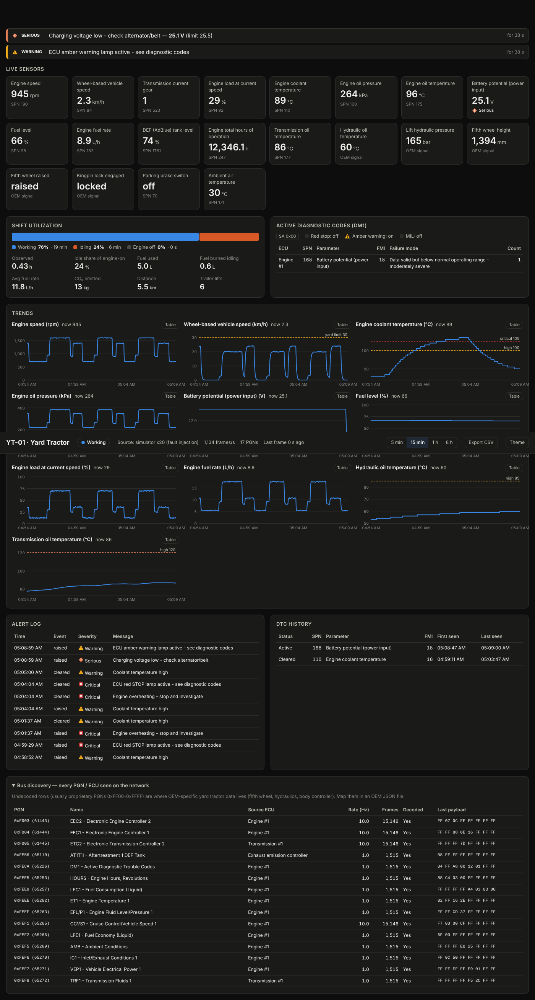

# Yard Tractor Telematics — prototype

A prototype edge gateway that connects to a yard (terminal) tractor's CAN bus,
decodes the ECU sensor readings (SAE J1939), and turns them into a live
dashboard with shift KPIs, alerts and diagnostic trouble codes.



```
 Yard tractor J1939 bus ──► CAN adapter ──► Gateway (Python) ──────────► Web dashboard
 (engine ECU, TCU, body      (listen-only)   • J1939 decode (PGN/SPN)     • live sensor tiles
  controller, after-                         • TP/BAM reassembly (DM1)    • shift utilization & fuel
  treatment, cluster)                        • state / KPIs / alerts      • trends + thresholds
                                             • SQLite history, CSV        • DTCs, alert log
                                             • raw candump recording      • bus discovery
```

It runs three ways with the same pipeline:

| Mode | Command | Use |
|---|---|---|
| Simulator | `python -m yard_telematics` | Demo/development with no truck. Simulates a yard duty cycle and injects faults (overheat, weak alternator, DPF) |
| Live truck | `python -m yard_telematics --source socketcan:can0` | Connect to a real tractor |
| Replay | `python -m yard_telematics --source replay:shift.candump --speed 10` | Re-run a recorded shift, e.g. to tune alerts |

Then open <http://127.0.0.1:8080/>.

## Quick start (no hardware)

```bash
cd telematics
python3 -m yard_telematics --speed 20      # 20× time so a shift's patterns show up within minutes
python3 -m unittest discover -s tests      # 16 tests
```

Requires Python 3.10 or later. The simulator, replay, storage and dashboard use only the standard library.
Install `python-can` (`pip install -r requirements.txt`) only for a live adapter.
The dashboard is self-contained (no CDN) because yard gateways are often offline.

## What it reads

**Standard J1939 signals (any engine ECU: Cummins, Volvo, Kalmar/Ottawa, Terberg, …)**

| Group | PGN | Signals (SPN) |
|---|---|---|
| EEC1/EEC2 | 61444 / 61443 | Engine speed (190), torque (513), pedal (91), load (92) |
| ETC2 | 61445 | Current gear (523) |
| ET1 | 65262 | Coolant temp (110), oil temp (175) |
| EFL/P1 | 65263 | Oil pressure (100), oil level (98) |
| CCVS1 | 65265 | Vehicle speed (84), parking brake (70), brake switch (597) |
| LFE1 / LFC1 | 65266 / 65257 | Fuel rate (183), total fuel used (250) |
| DD1 | 65276 | Fuel level (96) |
| VEP1 | 65271 | Battery voltage (168) |
| HOURS | 65253 | Engine hours (247) |
| IC1 / AMB / TRF1 | 65270 / 65269 / 65272 | Boost (102), intake temp (105), ambient (171), trans oil temp (177) |
| AT1T1I | 65110 | DEF/AdBlue level (1761) |
| DM1 | 65226 | Active DTCs (SPN, FMI, occurrence count) + lamp status, single-frame and multi-packet (BAM) |

**Yard-tractor-specific signals (fifth wheel height/raised, kingpin lock,
hydraulic pressure/temperature)** are OEM proprietary messages, not standard
J1939. They are defined in a JSON file. `config/oem_signals.example.json` is
an **invented example layout** that the simulator uses. For a real tractor,
replace it with the OEM's DBC/CAN spec, or reverse-engineer the layout with
the **Bus discovery** panel. That panel lists every PGN/ECU on the bus, its
rate, whether it is decoded, and its last payload.

## Dashboard and KPIs

- **Machine state**: Off (no EEC1 for 5 s, i.e. the bus is asleep) / Idle
  (engine running, below 1 km/h, pedal under 5 %) / Working.
- **Shift KPIs** (since gateway start): utilization %, idle share of engine-on
  time, fuel used, fuel burned idling, average L/h, CO₂ (2.68 kg/L diesel),
  distance, trailer lifts (fifth-wheel raise count).
- **Alerts** (`analytics.py → DEFAULT_RULES`): coolant above 100/105 °C, oil
  pressure below 100 kPa while running, charging voltage below 25.5 V while
  running (24 V system), fuel below 15 %/8 %, DEF below 10 %, transmission
  above 120 °C, hydraulic oil above 85 °C, yard speed above 30 km/h, plus ECU
  red/amber lamps from DM1. When two rules fire on the same signal, only the
  more severe alert is shown. **These are generic defaults. Tune them to the
  engine's OEM limits and your site's speed rules.**
- **API**: `/api/snapshot`, `/api/history?keys=…&minutes=…`, `/api/stream` (SSE),
  `/api/pgns`, `/api/dtc-history`, `/api/alerts`, `/api/export.csv`.

## Connecting to a real yard tractor

1. **Physical access.** Use the 9-pin Deutsch J1939 diagnostic connector in the
   cab: pin C = CAN_H, pin D = CAN_L, pin A = ground, pin B = battery +.
   For a permanent install, tap the backbone with a Y-cable or splice, never a
   third terminator.
2. **Adapter.** Any python-can interface works: PEAK PCAN-USB (`pcan:PCAN_USBBUS1`),
   Kvaser (`kvaser:0`), CANable/slcan (`slcan:/dev/ttyACM0`), or a Raspberry Pi
   with an MCP2515/PiCAN HAT (`socketcan:can0`). For in-vehicle use, choose a
   12/24 V-rated, isolated, automotive-grade unit.
3. **Bit rate.** 250 kbit/s is standard J1939. Some newer vehicles use 500 kbit/s
   (J1939-14). A wrong bit rate shows up as bus errors and zero decoded frames.
4. **Listen-only.** By default the gateway never transmits. Also put the
   *hardware* in silent mode so the adapter cannot even ACK frames:
   ```bash
   sudo ip link set can0 type can bitrate 250000 listen-only on
   sudo ip link set can0 up
   python3 -m yard_telematics --source socketcan:can0 --oem my_oem.json --record shift.candump
   ```
5. **On-request data.** Many engines only send engine hours and total fuel when
   asked. `--allow-transmit` sends a J1939 Request for these every 60 s,
   using diagnostic-tool address 0xF9. Use it only with the vehicle owner's
   approval, and not in hardware listen-only mode.
6. **Record first.** `--record` writes a candump log on the first drive, so
   alerts and OEM signal mappings can be developed offline with `replay:`.

## Code map

```
yard_telematics/
  j1939.py      CAN ID parsing, SPN bit extraction (with n/a / error detection), TP BAM/RTS reassembly, DM1
  signals.py    standard SPN catalog + OEM JSON loader
  sources.py    python-can live source, candump replay, candump writer
  simulator.py  yard tractor duty-cycle + fault-injection ECU simulator
  gateway.py    pipeline: decode → latest values → store → analytics; snapshot/discovery views
  analytics.py  machine state, shift KPIs, alert rules
  store.py      SQLite history (1 sample/signal/s, 30-day retention), DTC event log
  server.py     stdlib HTTP API + SSE
  static/index.html  dashboard (vanilla JS/SVG, light & dark)
```

## Prototype limits / next steps

- **Single vehicle, local only.** Fleet use needs an uplink, e.g. MQTT over
  LTE with store-and-forward, plus a central database and fleet dashboard.
  The `/api/snapshot` JSON is the natural payload.
- **No GPS.** Add a GNSS receiver for location, geofences (berth, stack,
  gate) and move/cycle times. Those are the KPIs terminal operators actually
  manage.
- **OEM signals are a placeholder.** Get the real PGN layouts from the
  tractor OEM (Kalmar, Terberg, Capacity, MAFI, …). Several OEMs also sell
  their own telematics, so compare against buying first.
- **Electric yard tractors** use different signals (battery SOC/SOH, motor and
  inverter temperatures, charging state). Add them through the same OEM JSON
  mechanism.
- **Shift boundaries.** KPIs currently reset when the gateway restarts. Tie
  them to operator login (RFID) or shift times.
- **Security.** The HTTP server has no authentication and binds to localhost
  by default. Add auth/TLS before exposing it on a network.
